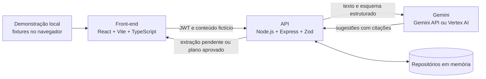

<p align="center"></p>

# HealthIA

Projeto acadêmico de Ciência da Computação da FMU (2026), desenvolvido como uma plataforma de apoio à decisão e à comunicação em saúde.

> A IA organiza informações presentes no texto de origem. Um profissional revisa e aprova cada sugestão antes que ela apareça no plano do paciente.

## Estado do projeto

Os repositórios são independentes. Este repositório contém a ideação, o contrato compartilhado da API, o protótipo estático e exemplos de dados fictícios. O código executável fica nos repositórios de front-end e back-end.

| Área | Estado atual |
| --- | --- |
| Alta Assistida | Fluxo executável integrado à API e em modo demonstração. Três etapas: paciente e sumário; decisão sobre cada sugestão com o trecho destacado no sumário; revisão final com termo de aceite (LGPD) e comprovante com hash do conteúdo. |
| Visão do paciente | Plano aprovado com sinais de alerta em destaque, medicamentos, cuidados e retornos, quem aprovou e quando, origem de cada item e impressão. |
| Prescrição Assistida | Parte da visão do produto; ainda não há módulo ou endpoints implementados. |
| Paciente Assistido | Parte da visão do produto; ainda não há módulo ou endpoints implementados. |
| Autenticação e persistência | JWT emitido e validado pela própria API; repositórios em memória. Supabase não está integrado à versão atual. |
| Produção e CI/CD | Imagens Docker e workflows de CI em cada repositório; deploy no Cloud Run em modo piloto (dados fictícios em memória). Guia em [`docs/deploy.md`](docs/deploy.md). |
| Extração com IA | Gemini pela Gemini API ou pelo Vertex AI, configurado no back-end. A demonstração usa conteúdo preparado e não chama serviços externos. |

## Arquitetura atual



Na demonstração, o front-end percorre o cenário completo no navegador, com as mesmas regras da API, sem Gemini e sem validação de credenciais. No modo integrado, o back-end valida o JWT e o perfil, verifica as citações contra o texto recebido e só gera o plano com o aceite do profissional, que confirma todas as declarações do termo vigente.

## Módulos

| Módulo | Público | Escopo previsto |
| --- | --- | --- |
| **Alta Assistida** | Profissional e paciente | Organizar o sumário de alta em sugestões rastreáveis e apresentar ao paciente apenas o plano aprovado. |
| **Prescrição Assistida** | Profissional de saúde | Estruturar prescrições e conferir itens com a fonte antes do registro. |
| **Paciente Assistido** | Profissional de saúde | Consultar informações disponíveis no histórico com indicação das fontes. |

Os dois últimos módulos são objetivos futuros, não funcionalidades disponíveis na versão atual.

## Repositórios

Cada parte tem seu próprio histórico Git e deve ser instalada e executada separadamente.

| Repositório | Responsabilidade | Guia |
| --- | --- | --- |
| [pitchInicial](https://github.com/FMU-Tech-Inovacao-2026-2/pitchInicial) | Ideação, contrato, protótipo estático e dados fictícios | Este README |
| [front-end](https://github.com/FMU-Tech-Inovacao-2026-2/front-end) | Aplicação web React | `FrontEnd/front-end/README.md` no workspace |
| [back-end](https://github.com/FMU-Tech-Inovacao-2026-2/back-end) | API Node.js + Express | `Backend/back-end/README.md` no workspace |

Consulte os READMEs de cada repositório para dependências, variáveis de ambiente, contas de desenvolvimento e comandos de teste. Não versione arquivos `.env`.

## Conteúdo deste repositório

```text
docs/
  checkpoint-1-documento-de-ideacao.md  Ideação e escopo acadêmico
  contrato-api.md                      Rotas e formatos implementados
  deploy.md                            Deploy no Cloud Run com Vertex AI
data/
  sumarios-ficticios/                   Sumários de exemplo inventados
prototipo/
  index.html                            Entrada estática
  home.html                             Home estática
  telas/                                Telas do protótipo visual
  assets/                               Logotipos e imagens
  fonte-canvas/                         Arquivos de origem do protótipo
```

Para visualizar o protótipo estático, abra `prototipo/index.html` no navegador. Ele serve para apresentação visual e não é a aplicação React executável.

## Contrato da API

O contrato vigente está em [`docs/contrato-api.md`](docs/contrato-api.md). Inclui login local, perfis, seleção de paciente e sumário, criação de extração, aprovação com itens editados e consulta do plano do próprio paciente. Atualize o contrato junto com qualquer mudança de rota ou payload. Funcionalidades futuras são identificadas como não implementadas.

## Segurança e limites clínicos

- Use somente dados fictícios em exemplos, demonstrações, documentação e testes.
- Não coloque chaves, tokens ou credenciais no Git. O `.env.example` contém apenas valores de exemplo.
- A IA não diagnostica, não recomenda tratamento, não completa lacunas e não altera prescrições.
- Sugestões precisam manter trecho de origem verificável e aprovação profissional antes de serem exibidas como plano.
- A demonstração não representa autenticação nem armazenamento real; a API atual usa contas fictícias e memória volátil.

## Equipe

| Nome | RA | Git |
| --- | --- | --- |
| Luiz Gustavo de Morais Pastori (Líder) | 3082115 | [LGDev666](https://github.com/LGDev666) |
| Gabriel de Oliveira Reis | 3227062 | [gabibribru](https://github.com/gabibribru) |
| Erick Moro Silva | 3009970 | [s1-cat](https://github.com/s1-cat) |
| Michel Anthony Barros Carreira | 2026106945 | [Michelbarros1](https://github.com/Michelbarros1) |
