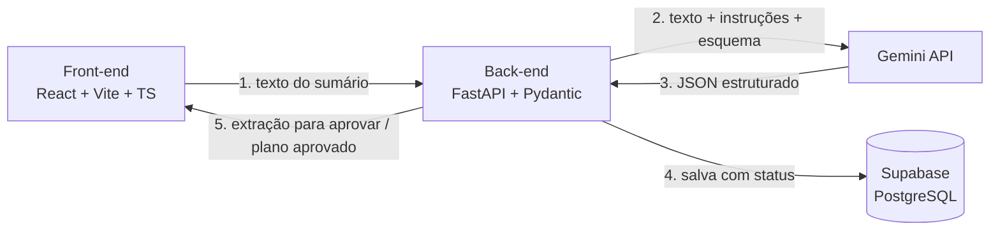

# Alta Assistida

> Nome provisório. Projeto do semestre — Ciência da Computação, FMU (2026).

Plataforma que transforma o **sumário de alta hospitalar**, escrito em linguagem técnica, num **plano de cuidados** que o paciente consegue seguir em casa. A IA organiza o que já está escrito no sumário, cada item aponta para o trecho de origem e **nada chega ao paciente sem a aprovação de um profissional de saúde**.

## Como funciona



1. O profissional cola o texto do sumário de alta.
2. O back-end envia o texto ao Gemini com instruções fixas e esquema de saída obrigatório.
3. O back-end valida o JSON e confere se cada `trecho_origem` existe no texto original. O que não confere é sinalizado.
4. A extração fica salva com status `pendente` até o profissional aprovar.
5. O paciente vê o plano aprovado: checklist, cronograma de remédios e alertas.

## Stack

| Camada | Tecnologia |
| --- | --- |
| Front-end | React, Vite, TypeScript, Tailwind CSS |
| Back-end | Python, FastAPI, Pydantic |
| IA | Gemini API (saída estruturada) |
| Dados | Supabase (PostgreSQL) |

## Estrutura do repositório

```
alta-assistida/
├── docs/
│   ├── checkpoint-1-documento-de-ideacao.md   # entrega do Checkpoint 1
│   └── contrato-api.md                         # endpoints e formato da extração
├── data/
│   └── sumarios-ficticios/                     # massa de teste (somente dados fictícios)
├── frontend/                                   # a criar na fase de fundação (31/10 a 08/11)
├── backend/                                    # a criar na fase de fundação (31/10 a 08/11)
├── .env.example
└── .gitignore
```

## Cronograma

| Período | Fase |
| --- | --- |
| até 30/10 | Checkpoint 1 — documento de ideação |
| 31/10 a 08/11 | Fundação — setup e um endpoint de ponta a ponta |
| 09/11 a 27/11 | Protótipo funcional |
| 28/11 a 30/11 | Code freeze |
| 01/12 a 06/12 | Vídeo, README final e ensaio do pitch |
| 07/12 e 08/12 | Apresentação final |

## Regras do projeto

- **Somente dados fictícios.** Dados de saúde são dados pessoais sensíveis (LGPD, Lei nº 13.709/2018). Nenhum dado real de paciente entra neste repositório.
- **Segredos fora do Git.** A chave da Gemini API e as credenciais do Supabase ficam em `.env`, que está no `.gitignore`. Use `.env.example` como modelo.
- **A IA não diagnostica.** Ela organiza o que está escrito; o que falta aparece como "não informado".
- **Branches:** `feat/<nome>` e `fix/<nome>`, com pull request para `main`.

## Equipe

| Integrante | Papel |
| --- | --- |
| Gabriel Reis | [papel] |
| [nome] | [papel] |
| [nome] | [papel] |
| [nome] | [papel] |
