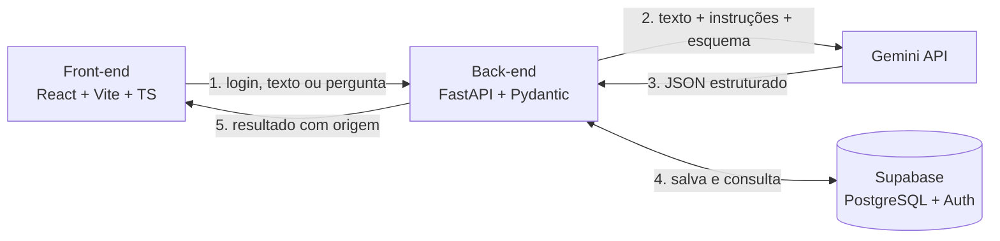

<p align="center"></p>

# HealthIA

> Projeto do semestre — Ciência da Computação, FMU (2026).

Plataforma de apoio à decisão e à comunicação em saúde. A IA organiza o que já está escrito, cada item aponta para o trecho ou registro de origem e **nada chega ao paciente nem entra na ficha sem a aprovação de um profissional de saúde**.

## Módulos

| Módulo | Quem usa | O que faz |
| --- | --- | --- |
| **Alta Assistida** | Profissional e paciente | Transforma o sumário de alta hospitalar num plano de cuidados que o paciente segue em casa |
| **Prescrição Assistida** | Médico | Estrutura a prescrição em texto livre, confere a origem de cada item, avisa sobre alergias e registra só após aprovação |
| **Paciente Assistido** | Médico | Chatbot que responde sobre prescrições, internações, alergias e histórico (geral ou recente) do paciente, citando a fonte |

A plataforma tem **página de login** e uma **home** que mostra os módulos liberados para o perfil do usuário. O Alta Assistida, que era o app inteiro, agora é um módulo.

## Como funciona



1. O usuário entra pelo login e o front-end envia o token em cada chamada.
2. O back-end valida o perfil e envia o texto ou a pergunta ao Gemini com instruções fixas e esquema de saída obrigatório.
3. O back-end valida o JSON e confere se cada `trecho_origem` (ou registro citado) existe. O que não confere é sinalizado.
4. Extrações ficam com status `pendente` até o profissional aprovar.
5. O resultado volta ao front-end: extração para aprovar, plano do paciente ou resposta do chat com as fontes.

## Stack

| Camada | Tecnologia |
| --- | --- |
| Front-end | React, Vite, TypeScript, Tailwind CSS |
| Back-end | Python, FastAPI, Pydantic |
| IA | Gemini API (saída estruturada) |
| Dados e login | Supabase (PostgreSQL e Auth) |

## Estrutura do repositório

```
healthia/
├── docs/
│   ├── checkpoint-1-documento-de-ideacao.md   # documento de ideação (revisado)
│   └── contrato-api.md                         # endpoints e formatos
├── data/
│   └── sumarios-ficticios/                     # massa de teste (somente dados fictícios)
├── prototipo/                                  # protótipo visual estático
│   ├── index.html                              # login
│   ├── home.html                               # home com os módulos
│   ├── assets/                                 # logo.svg e logo-icone.svg
│   └── telas/                                  # telas do Alta Assistida
├── frontend/                                   # a criar
├── backend/                                    # a criar
├── .env.example
└── .gitignore
```

Para ver o protótipo, abra `prototipo/index.html` no navegador.

## Cronograma

| Período | Fase |
| --- | --- |
| até 30/10 | Checkpoint 1 — documento de ideação |
| 31/10 a 08/11 | Fundação — setup e um endpoint de ponta a ponta |
| 09/11 a 27/11 | Protótipo funcional — login, home e os três módulos |
| 28/11 a 30/11 | Code freeze |
| 01/12 a 06/12 | Vídeo, README final e ensaio do pitch |
| 07/12 e 08/12 | Apresentação final |

## Regras do projeto

- **Somente dados fictícios.** Dados de saúde são dados pessoais sensíveis (LGPD, Lei nº 13.709/2018). Nenhum dado real de paciente entra neste repositório.
- **Segredos fora do Git.** A chave da Gemini API e as credenciais do Supabase ficam em `.env`, que está no `.gitignore`. Use `.env.example` como modelo.
- **A IA não diagnostica.** Ela organiza o que está escrito; o que falta aparece como "não informado" ou "não consta no histórico".
- **Branches:** `feat/<nome>` e `fix/<nome>`, com pull request para `main`.

## Equipe

| Nome | RA | Git |
| --- | --- | --- |
| Luiz Gustavo de Morais Pastori (Líder) | 3082115 | [LGDev666](https://github.com/LGDev666) |
| Gabriel de Oliveira Reis | 3227062 | [gabibribru](https://github.com/gabibribru) |
| Erick Moro Silva | 3009970 | [s1-cat](https://github.com/s1-cat) |
| Michel Anthony Barros Carreira | 2026106945 | [Michelbarros1](https://github.com/Michelbarros1) |
