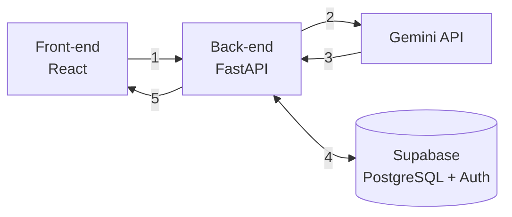

# Documento de Ideação — HealthIA

Checkpoint 1 · 29/10/2026 · revisado em 11/11/2026 (nova concepção: plataforma com três módulos)

## Identificação

HealthIA é uma plataforma de apoio à decisão e à comunicação em saúde. Ela reúne três módulos que usam IA para organizar informação clínica já escrita, sempre com conferência de origem e aprovação de um profissional de saúde.

| Campo | Valor |
| --- | --- |
| Projeto | HealthIA |
| Curso | Ciência da Computação — FMU |
| Entrega | Checkpoint 1 — documento de ideação |
| Organização | https://github.com/FMU-Tech-Inovacao-2026-2 (publico) |

### Equipe

| Nome | RA | Git |
| --- | --- | --- |
| Luiz Gustavo de Morais Pastori (Líder) | 3082115 | https://github.com/LGDev666 |
| Gabriel de Oliveira Reis | 3227062 | https://github.com/gabibribru |
| Erick Moro Silva | 3009970 | https://github.com/s1-cat |
| Michel Anthony Barros Carreira | 2026106945 | https://github.com/Michelbarros1 |

## Visão geral da plataforma

O que era o app inteiro, o Alta Assistida, passa a ser um módulo da HealthIA. A plataforma ganha uma página de login, uma home e dois módulos novos.

| Parte | Quem usa | O que faz |
| --- | --- | --- |
| Login | Todos | Identifica o usuário e libera o perfil de acesso |
| Home | Todos | Mostra os módulos disponíveis para o perfil do usuário |
| Alta Assistida | Profissional e paciente | Transforma o sumário de alta num plano de cuidados para o paciente |
| Prescrição Assistida | Médico | Transforma a prescrição escrita pelo médico em itens estruturados, conferidos e aprovados |
| Paciente Assistido | Médico | Chatbot que responde perguntas sobre prescrições, internações, alergias e histórico do paciente |

Os três módulos compartilham as mesmas regras: a IA só organiza o que está escrito, cada item aponta para o trecho de origem, e nada é registrado ou entregue sem a aprovação de um profissional.
>>>>>>> 303a0b9 (V2)

## Problema

Informação clínica importante está espalhada em textos escritos para outros profissionais, em linguagem técnica e abreviada. Isso gera três dores.

1. **Na alta.** O paciente recebe um sumário escrito para profissionais de saúde. Em casa, sem apoio, ele ou o cuidador precisa interpretar o texto sozinho. Erros nessa etapa, como tomar a dose errada, manter um remédio suspenso ou esquecer um retorno, contribuem para complicações e reinternações.
2. **Na prescrição.** A prescrição escrita em texto livre precisa ser lida, conferida e transcrita para o registro do paciente. Abreviações, doses e frequências ambíguas são fonte de erro.
3. **Na consulta ao histórico.** Para decidir, o médico precisa cruzar prescrições, internações, alergias e evolução recente, hoje espalhadas em vários documentos. Achar uma alergia ou uma dose anterior leva tempo e pode passar despercebido.

Um estudo que acompanhou 400 pacientes após a alta de um serviço de clínica médica encontrou eventos adversos em 19% deles, e dois terços desses eventos estavam ligados a medicamentos ([Forster et al., Annals of Internal Medicine, 2003](https://psnet.ahrq.gov/issue/incidence-and-severity-adverse-events-affecting-patients-after-discharge-hospital); números relatados em [Clinician.com](https://www.clinician.com/articles/28487-safety-concerns-should-not-end-with-discharge)).

## Módulos

### Alta Assistida

A IA organiza o que já está escrito no sumário, o profissional confere e aprova, e só então o paciente recebe o plano.

1. **Envio.** O profissional de saúde cola o texto do sumário de alta.
2. **Extração.** A IA (Gemini API) identifica medicamentos, doses, frequências, duração, horários, alertas, orientações e retornos, e devolve tudo em formato estruturado.
3. **Verificação de origem.** Cada item extraído traz o trecho do sumário de onde saiu. O sistema confere se esse trecho existe no texto original; o que não confere é sinalizado e não segue adiante.
4. **Aprovação.** O profissional revisa a extração, corrige se necessário e aprova.
5. **Plano do paciente.** O paciente ou cuidador vê um dashboard com checklist de cuidados, cronograma de remédios por horário e alertas em linguagem simples.

**O que muda para o paciente.** Em vez de interpretar "AAS 100mg 1x/dia VO após almoço", ele vê "AAS 100 mg — 1 comprimido por dia, depois do almoço" no horário certo do cronograma, com o trecho original disponível para conferência.

### Prescrição Assistida

Recicla o motor do Alta Assistida (extração estruturada, verificação de origem e aprovação), agora aplicado às prescrições do médico.

1. **Entrada.** O médico escreve ou cola a prescrição em texto livre, vinculada a um paciente.
2. **Extração.** A IA estrutura cada item: medicamento, dose, via, frequência, duração e orientação.
3. **Verificação de origem.** O back-end confere se o trecho de cada item existe na prescrição enviada.
4. **Conferência com a ficha.** O sistema compara os medicamentos extraídos com as alergias registradas do paciente e mostra um aviso quando há coincidência. O aviso é informativo; a decisão continua sendo do médico.
5. **Aprovação.** O médico revisa, corrige e aprova. Só a prescrição aprovada entra na ficha do paciente.

O módulo não sugere medicamento, não altera dose e não completa campo ausente: o que falta aparece como "não informado".

### Paciente Assistido

É o chatbot do médico. Ele conversa com os dados do paciente: prescrições, internações, alergias e histórico geral ou recente.

1. **Seleção.** O médico escolhe o paciente e, se quiser, o período (histórico geral ou recente).
2. **Pergunta.** O médico escreve em linguagem natural, por exemplo: "Quais medicamentos ele usa hoje?" ou "Ele tem alguma alergia registrada?".
3. **Resposta com fonte.** A IA responde apenas com base nos registros daquele paciente e cita, em cada afirmação, o registro de onde veio (prescrição, internação, alergia). O back-end confere se o registro citado existe.
4. **Limites.** Se a informação não está na ficha, a resposta é "não consta no histórico". O chatbot não diagnostica, não sugere conduta e não responde sobre pacientes que o médico não selecionou.

## Escopo do MVP

O protótipo funcional, previsto para 27/11, entrega o fluxo completo do Alta Assistida e uma primeira versão dos dois módulos novos, com dados fictícios.

| Entra no MVP | Fica para depois |
| --- | --- |
| Login com e-mail e senha e dois perfis (profissional e paciente) | Login com MFA, recuperação de senha e auditoria completa de acessos |
| Home com os módulos liberados para cada perfil | Personalização da home e painel de indicadores |
| Alta Assistida: envio, revisão e aprovação; dashboard do paciente | Leitura de PDF ou imagem do sumário |
| Prescrição Assistida: texto da prescrição, extração, origem verificada, aviso de alergia e aprovação | Checagem de interações medicamentosas e de dose máxima |
| Paciente Assistido: chat sobre prescrições, internações, alergias e histórico de pacientes fictícios, com fonte em cada resposta | Chat com voz, anexos e histórico de conversas |
| Verificação do trecho ou registro de origem de cada item | Integração com prontuários eletrônicos (HL7 FHIR) |
| Mensagens claras para lacunas ("não informado", "não consta no histórico") | Lembretes e notificações por WhatsApp |
| Sumários, prescrições e fichas de pacientes fictícios para teste e demonstração | Qualquer uso com dados reais de pacientes |

**Critérios de sucesso do protótipo.**

- Nenhum medicamento, dose ou horário aparece no plano, na ficha ou na resposta do chat sem trecho ou registro correspondente.
- Nos casos de teste, todos os medicamentos escritos no texto aparecem na extração.
- Textos incompletos ou confusos geram aviso, não uma resposta inventada.
- Perguntas do chat sobre algo ausente da ficha recebem "não consta no histórico".
- Um usuário sem login não acessa nenhuma tela além do login.
- O fluxo completo, do login a cada módulo, roda na apresentação sem intervenção manual.

## Arquitetura

O back-end é o único componente que fala com a IA e com o banco, e é nele que cada item extraído ou citado tem a origem conferida.

1. O usuário entra pela página de login (Supabase Auth) e o front-end envia o token em cada chamada.
2. O back-end valida o token, confere o perfil e envia o texto ou a pergunta ao Gemini com instruções fixas e um esquema de saída obrigatório.
3. O Gemini devolve JSON; o back-end valida o formato e confere se cada trecho ou registro citado existe.
4. O back-end salva e consulta no Supabase: sumários, prescrições, fichas e extrações, com status pendente até a aprovação.
5. O front-end mostra o resultado: extração para aprovar, plano do paciente ou resposta do chat com as fontes.

### Dados principais

| Entidade | Conteúdo |
| --- | --- |
| Usuário | E-mail, perfil (profissional ou paciente) |
| Paciente (fictício) | Identificação inventada, alergias, internações |
| Sumário de alta | Texto enviado, extração, status |
| Prescrição | Texto enviado, itens extraídos, status, paciente vinculado |
| Conversa | Mensagens do chat e registros citados |

| Camada | Tecnologia | Motivo da escolha |
| --- | --- | --- |
| Front-end | React, Vite, TypeScript, Tailwind CSS | Mesma base usada no Hackathon FMU (Finance-ai) |
| Back-end | Python, FastAPI, Pydantic | Validação do JSON da IA com pouco código |
| IA | Gemini API com saída estruturada | Modelo usado sem treinamento próprio |
| Dados e login | Supabase (PostgreSQL e Auth) | Banco e autenticação gerenciados, sem infraestrutura para manter |
| Versionamento | GitHub | Repositório do projeto na organização da turma |

## Identidade visual

O nome HealthIA junta *health* (saúde) e *IA*. A interface deve transmitir confiança e clareza, com o dashboard do paciente legível por pessoas idosas e cuidadores sem formação técnica.

**Logo.** Um quadrado de cantos arredondados em azul profundo, com uma cruz branca e uma linha de batimento em verde clínico cruzando o braço horizontal. A cruz representa a saúde e o pulso, a IA que acompanha o cuidado. No nome, "Health" aparece em azul profundo e "IA" em verde clínico. Os arquivos estão em `prototipo/assets/` (`logo.svg` e `logo-icone.svg`).

| Cor | Hex | Uso |
| --- | --- | --- |
| Azul profundo | #142D4E | Cabeçalho, títulos, botão principal |
| Verde clínico | #187C80 | Itens concluídos, confirmações e destaque da marca |
| Cinza claro | #F4F7FA | Fundo das telas |
| Branco | #FFFFFF | Cartões e áreas de conteúdo |
| Âmbar | #B45309 | Alertas de cuidado e avisos de alergia |
| Vermelho | #B3261E | Item sem origem verificada e sinais de alerta |

**Tipografia.** Inter, pesos 600 para títulos e 400 para texto. No dashboard do paciente, corpo de texto com no mínimo 16 px e contraste adequado para leitura.

**Telas do protótipo.** Login, home, e as telas de cada módulo. Alta Assistida tem envio, revisão e plano do paciente. Prescrição Assistida e Paciente Assistido ainda estão em desenho. O protótipo navegável está em `prototipo/`.

## Segurança, privacidade e limites da IA

O projeto trata a IA como organizadora de texto sob supervisão humana, e usa somente dados fictícios.

- **Sem dados reais.** Dados de saúde são dados pessoais sensíveis pela LGPD (Lei nº 13.709/2018). O protótipo usa apenas sumários, prescrições e fichas escritos pela equipe.
- **Acesso por perfil.** Todas as rotas exigem login. O paciente só vê o próprio plano aprovado; os módulos de Prescrição e Paciente Assistido são exclusivos do profissional.
- **Sem diagnóstico.** A IA não interpreta exames, não sugere tratamento, não altera prescrição e não completa informações ausentes; o que falta aparece como "não informado" ou "não consta no histórico".
- **Rastreabilidade.** Todo item do plano, da prescrição ou da resposta do chat aponta para o trecho ou registro que o originou, e o back-end confere essa origem antes de salvar ou exibir.
- **Aprovação humana obrigatória.** Nenhuma extração chega ao paciente nem entra na ficha sem aprovação do profissional.
- **Chaves protegidas.** A chave da Gemini API e as credenciais do Supabase ficam apenas no back-end, em variável de ambiente, fora do repositório.
- **Termos do provedor.** Os termos do plano gratuito da Gemini API sobre uso dos dados enviados serão conferidos antes da implementação; mais um motivo para não usar dados reais.

## Cronograma

O protótipo funcional fica pronto em 27/11, com o código congelado a partir de 28/11 para a apresentação de 07/12 e 08/12.

| Período | Fase | Entregas | Responsáveis |
| --- | --- | --- | --- |
| até 30/10 | Checkpoint 1 | Documento de ideação, identidade visual, arquitetura e roteiro do pitch | Todos |
| 31/10 a 08/11 | Fundação | Repositório, projeto no Supabase, chave da API no back-end, um endpoint funcionando de ponta a ponta | Pessoas 1 e 2 |
| 09/11 a 27/11 | Protótipo | Login e home, Alta Assistida completo, Prescrição Assistida e Paciente Assistido em versão inicial, dados fictícios e casos extremos de teste | Pessoas 1, 2 e 3 |
| 28/11 a 30/11 | Code freeze | Apenas correção de erros | Pessoas 1 e 2 |
| 01/12 a 06/12 | Preparação | Vídeo de demonstração, README, ensaio do pitch, ambiente local testado | Pessoas 3 e 4 |
| 07/12 e 08/12 | Apresentação final | Pitch de 5 minutos e demonstração ao vivo | Todos |

## Riscos e mitigações

O risco principal é a IA extrair ou citar uma informação errada; a verificação de origem e a aprovação humana existem para contê-lo.

| Risco | Mitigação |
| --- | --- |
| A IA extrai dose, horário ou medicamento errado | Trecho de origem conferido pelo back-end e aprovação obrigatória do profissional |
| A IA omite um medicamento presente no texto | Casos de teste com a lista esperada de medicamentos, conferidos a cada mudança no prompt |
| O chat inventa uma informação que não está na ficha | Resposta restrita aos registros do paciente, com fonte obrigatória e resposta "não consta no histórico" |
| O chat mistura dados de pacientes diferentes | Cada conversa fica presa a um único paciente selecionado, e o back-end filtra os registros por ele |
| Três módulos não cabem no prazo | Alta Assistida primeiro; os outros dois entram em versão enxuta, reaproveitando o motor de extração |
| A Gemini API falha ou atinge o limite na apresentação | Modo demonstração com respostas salvas dos casos de teste e vídeo gravado como plano B |
| Atraso na integração entre front-end e back-end | Endpoint de ponta a ponta funcionando já na fase de fundação, antes de 09/11 |
