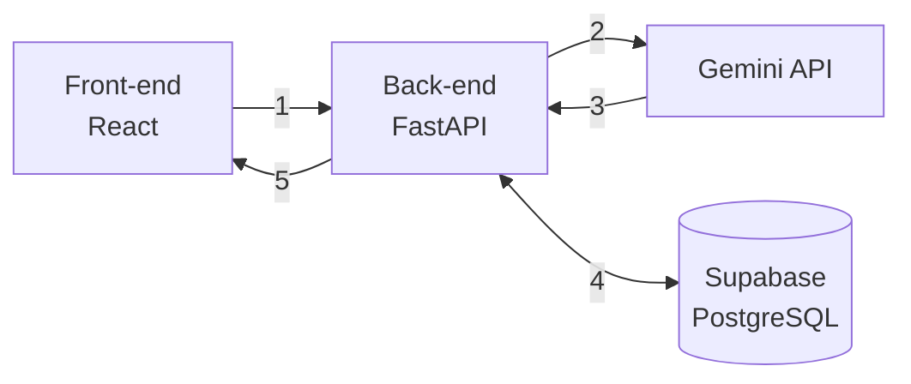

# Documento de Ideação — Alta Assistida

Checkpoint 1 · 29/10/2026

## Identificação

Alta Assistida (nome provisório) transforma o sumário de alta hospitalar num plano de cuidados que o paciente consegue seguir em casa, com aprovação de um profissional de saúde antes de qualquer informação chegar ao paciente.

| Campo | Valor |
| --- | --- |
| Curso | Ciência da Computação — FMU |
| Entrega | Checkpoint 1 — documento de ideação |
| Organização | [github.com/gabibribru/alta-assistida](https://github.com/FMU-Tech-Inovacao-2026-2) (publico) |

## Problema

Na alta hospitalar, o paciente recebe um sumário escrito para outros profissionais de saúde, não para ele.

O documento reúne diagnósticos, medicamentos novos, mudanças de dose, horários, cuidados e retornos, quase sempre em linguagem técnica e abreviada. Em casa, sem o profissional por perto, o paciente ou o cuidador precisa interpretar esse texto sozinho. Erros nessa etapa, como tomar a dose errada, manter um remédio suspenso ou esquecer um retorno, contribuem para complicações e reinternações.

Um estudo que acompanhou 400 pacientes após a alta de um serviço de clínica médica encontrou eventos adversos em 19% deles, e dois terços desses eventos estavam ligados a medicamentos ([Forster et al., Annals of Internal Medicine, 2003](https://psnet.ahrq.gov/issue/incidence-and-severity-adverse-events-affecting-patients-after-discharge-hospital); números relatados em [Clinician.com](https://www.clinician.com/articles/28487-safety-concerns-should-not-end-with-discharge)).

## Solução proposta

A IA organiza o que já está escrito no sumário, o profissional confere e aprova, e só então o paciente recebe o plano.

1. **Envio.** O profissional de saúde cola o texto do sumário de alta na plataforma.
2. **Extração.** A IA (Gemini API) identifica medicamentos, doses, frequências, duração, horários, alertas, orientações e retornos, e devolve tudo em formato estruturado.
3. **Verificação de origem.** Cada item extraído traz o trecho do sumário de onde saiu. O sistema confere se esse trecho existe no texto original; o que não confere é sinalizado e não segue adiante.
4. **Aprovação.** O profissional revisa a extração, corrige se necessário e aprova.
5. **Plano do paciente.** O paciente ou cuidador vê um dashboard com checklist de cuidados, cronograma de remédios por horário e alertas em linguagem simples.

**Usuários.** O profissional de saúde, que envia e aprova, e o paciente ou cuidador, que consulta o plano aprovado.

**O que muda para o paciente.** Em vez de interpretar "AAS 100mg 1x/dia VO após almoço", ele vê "AAS 100 mg — 1 comprimido por dia, depois do almoço" no horário certo do cronograma, com o trecho original disponível para conferência.

## Escopo do MVP

O protótipo funcional, previsto para 27/11, entrega o fluxo completo para um sumário de alta em texto, com dados fictícios.

| Entra no MVP | Fica para depois |
| --- | --- |
| Tela de envio, revisão e aprovação pelo profissional | Login e perfis de acesso completos |
| Extração estruturada via Gemini API | Leitura de PDF ou imagem do sumário |
| Verificação do trecho de origem de cada item | Integração com prontuários eletrônicos (HL7 FHIR) |
| Dashboard do paciente: checklist, cronograma e alertas | Lembretes e notificações por WhatsApp |
| Mensagens claras para lacunas ("não informado", laudo sem medicamentos) | Chat com a IA sobre o histórico |
| 3 a 5 sumários de alta fictícios para teste e demonstração | Qualquer uso com dados reais de pacientes |

**Critérios de sucesso do protótipo.**

- Nenhum medicamento, dose ou horário aparece no plano sem trecho correspondente no sumário.
- Nos sumários de teste, todos os medicamentos escritos no texto aparecem na extração.
- Sumários incompletos ou confusos geram aviso, não uma resposta inventada.
- O fluxo completo, do envio ao dashboard, roda na apresentação sem intervenção manual.

## Arquitetura

O back-end é o único componente que fala com a IA e com o banco, e é nele que cada item extraído tem a origem conferida.

1. O profissional envia o texto do sumário pela tela de envio.
2. O back-end envia o texto ao Gemini com instruções fixas e um esquema de saída obrigatório.
3. O Gemini devolve JSON; o back-end valida o formato e confere se cada trecho de origem existe no texto.
4. O back-end salva sumário e extração no Supabase com status pendente; a aprovação muda o status para aprovado.
5. O front-end mostra a extração para aprovação e, depois, o plano aprovado ao paciente.

| Camada | Tecnologia | Motivo da escolha |
| --- | --- | --- |
| Front-end | React, Vite, TypeScript, Tailwind CSS | Mesma base usada no Hackathon FMU (Finance-ai) |
| Back-end | Python, FastAPI, Pydantic | Validação do JSON da IA com pouco código |
| IA | Gemini API com saída estruturada | Modelo usado sem treinamento próprio |
| Dados | Supabase (PostgreSQL) | Banco gerenciado, sem infraestrutura para manter |
| Versionamento | GitHub | Repositório privado do projeto |

## Identidade visual

A interface deve transmitir confiança e clareza, com o dashboard do paciente legível por pessoas idosas e cuidadores sem formação técnica.

| Cor | Hex | Uso |
| --- | --- | --- |
| Azul profundo | #142D4E | Cabeçalho, títulos, botão principal |
| Verde clínico | #187C80 | Itens concluídos e confirmações |
| Cinza claro | #F4F7FA | Fundo das telas |
| Branco | #FFFFFF | Cartões e áreas de conteúdo |
| Âmbar | [hex] | Alertas de cuidado |
| Vermelho | [hex] | Item sem origem verificada e sinais de alerta |

**Tipografia.** Inter, pesos 600 para títulos e 400 para texto. No dashboard do paciente, corpo de texto com no mínimo 16 px e contraste adequado para leitura.

**Telas do MVP.** Tela de envio e aprovação (profissional) e dashboard de alta (paciente). [Inserir os wireframes das duas telas.]

## Segurança, privacidade e limites da IA

O projeto trata a IA como organizadora de texto sob supervisão humana, e usa somente dados fictícios.

- **Sem dados reais.** Dados de saúde são dados pessoais sensíveis pela LGPD (Lei nº 13.709/2018). O protótipo usa apenas sumários de alta escritos pela equipe.
- **Sem diagnóstico.** A IA não interpreta exames, não sugere tratamento, não altera prescrição e não completa informações ausentes; o que falta aparece como "não informado".
- **Rastreabilidade.** Todo item do plano aponta para o trecho do sumário que o originou, e o back-end confere esse trecho antes de salvar.
- **Aprovação humana obrigatória.** Nenhuma extração chega ao paciente sem aprovação do profissional.
- **Chaves protegidas.** A chave da Gemini API fica apenas no back-end, em variável de ambiente, fora do repositório.
- **Termos do provedor.** Os termos do plano gratuito da Gemini API sobre uso dos dados enviados serão conferidos antes da implementação; mais um motivo para não usar dados reais.

## Cronograma

O protótipo funcional fica pronto em 27/11, com o código congelado a partir de 28/11 para a apresentação de 07/12 e 08/12.

| Período | Fase | Entregas | Responsáveis |
| --- | --- | --- | --- |
| até 30/10 | Checkpoint 1 | Documento de ideação, identidade visual, arquitetura e roteiro do pitch | Todos |
| 31/10 a 08/11 | Fundação | Repositório, projeto no Supabase, chave da API no back-end, um endpoint funcionando de ponta a ponta | Pessoas 1 e 2 |
| 09/11 a 27/11 | Protótipo | Duas telas, endpoint de extração com verificação de origem, sumários fictícios e casos extremos de teste | Pessoas 1, 2 e 3 |
| 28/11 a 30/11 | Code freeze | Apenas correção de erros | Pessoas 1 e 2 |
| 01/12 a 06/12 | Preparação | Vídeo de demonstração, README, ensaio do pitch, ambiente local testado | Pessoas 3 e 4 |
| 07/12 e 08/12 | Apresentação final | Pitch de 5 minutos e demonstração ao vivo | Todos |

## Riscos e mitigações

O risco principal é a IA extrair uma informação errada; a verificação de origem e a aprovação humana existem para contê-lo.

| Risco | Mitigação |
| --- | --- |
| A IA extrai dose, horário ou medicamento errado | Trecho de origem conferido pelo back-end e aprovação obrigatória do profissional |
| A IA omite um medicamento presente no sumário | Casos de teste com a lista esperada de medicamentos, conferidos a cada mudança no prompt |
| A Gemini API falha ou atinge o limite na apresentação | Modo demonstração com respostas salvas dos sumários de teste e vídeo gravado como plano B |
| Atraso na integração entre front-end e back-end | Endpoint de ponta a ponta funcionando já na fase de fundação, antes de 09/11 |
